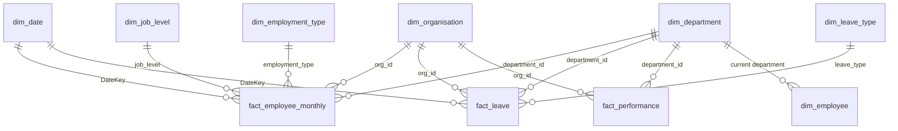

# CloudHR data model design

One imported Power BI dataset serves every CloudHR client. Row-level security, not a separate report per client, keeps each organisation on its own data. The refresh is weekly. The grain of the workforce fact is monthly, because that is how the source system stores a month-end balance.

The source window is January 2024 through December 2025. `employee_count_band` is the active headcount on 31 December 2025.

## 1. The monthly snapshot is the fact, not the employee table

`fact_employee_monthly` comes from `employee_monthly_snapshots`, joined to the current employee version for hire date, termination date, and termination reason.

The grain is one row per employee per month-end. That is the grain of every headline question: how many people were employed at the end of the period, what they were paid then, which department they sat in, and which job level they held. Those attributes change over time. A monthly row records the state after the change.

`employees` is a Type 2 history of the person, not a fact. One person has one or two versions (`effective_start`, `effective_end`, `is_current`). Using that table as the fact would make headcount a count of versions, or a count of people who happen to be current today. Neither of those is "headcount in the period the user selected." A slicer on `hire_date` would answer "who joined in this period," and it would not answer "who was on the books at the end of this period."

Headcount is a count of snapshot rows with `is_active` true at one month-end. It is not `COUNTROWS` of `employees`, and it is not a sum of a headcount column. Summing a 1/0 flag across months would count the same person once per month.

Two other facts sit beside it, because their grains are different:

| Table | Grain | What it is for |
|---|---|---|
| `fact_employee_monthly` | Employee × month-end | Headcount, pay, tenure, movement |
| `fact_leave` | One approved leave | Days taken, utilization |
| `fact_performance` | Employee × review year | Average rating |

Leave days are additive. A rating is not: it is averaged for the selected years, never summed. Performance has no relationship to `dim_date`. The rating measure takes the years in context with `TREATAS`. A relationship on 1 January would make a quarter slicer drop every review that did not fall in that quarter.

Names stay off the monthly fact. They are not required to compute any measure, and repeating them on 628,428 rows widens the model for no analytical gain. `dim_employee` keeps `first_name`, `last_name`, and `Full Name` for the current roster. RLS is what stops another tenant from reading those names.

## 2. Headcount is semi-additive

Headcount is a balance, the same shape as inventory or a bank balance. It adds across organisation, department, job level, and employment type. It does not add across time.

If January ends at 100 people, February at 102, and March at 99, a simple `SUM` for "Q1 2025" returns 301. The organisation does not have 301 employees. Almost everyone in January is still there in March, so the sum triple-counts them. The number the business asked for is 99: the balance on the last day of the selected period.

That is why `Active Headcount` and `Headcount EOP` both pin the filter to a single `snapshot_date`:

- `Active Headcount` uses the latest loaded month-end on or before the end of the selection. A slicer that runs into a month the refresh has not loaded yet still shows the last real balance.
- `Headcount EOP` uses the calendar month-end of the selection and returns blank if that month is not loaded. Turnover uses this as the closing balance, so a missing month does not silently reuse an older one.
- `Headcount BOP` uses the month-end before the selection starts. `FIRSTDATE` of 2025 is 1 January, and there is no snapshot on 1 January. `EOMONTH` of that date, minus one month, is 31 December 2024, which is the true opening balance. For 2024 there is no December 2023 snapshot, so the measure falls back to 31 January 2024. Turnover for 2024 is therefore slightly biased; 2025 is not.

`Headcount YTD` applies `DATESYTD` first and then the same last-date rule. On a month axis, March shows the 31 March balance, not January plus February plus March. Combining the two patterns is the whole point of the measure. A year-to-date sum of monthly headcounts would be the same mistake as the Q1 sum, spread over more months.

`Headcount YoY Growth %` compares the two balances. It is blank for 2024 because there are no 2023 facts. That is correct. The date table still contains 2023 so `SAMEPERIODLASTYEAR` has dates to shift onto; without those dates the function returns an error or an empty shift rather than a clean blank.

Check, with Year = 2025 and organisation = Acme Labs, before RLS is applied:

| Measure | Expected |
|---|---|
| Active Headcount | 84 |
| Headcount EOP | 84 |
| Headcount BOP | 77 |
| Headcount YoY Growth % | 9.09 |
| New Hires | 13 |
| Terminations | 6 |
| Turnover Rate | 7.45 |
| Voluntary Terminations | 1 |
| Avg Base Salary | 91,107.63 |
| Leave Days | 708 |

BrightPath Logistics at December 2025 is 86 people and an average salary of 82,695.26. Cedar Health is 66 people and 85,166.33. Those two figures are the negative test for RLS.

## 3. Relationships

Filter direction is single, from the dimension to the fact, unless the table says otherwise.

| From | To | Key | Active |
|---|---|---|---|
| `dim_date[DateKey]` | `fact_employee_monthly[DateKey]` | month-end | Yes |
| `dim_date[DateKey]` | `fact_leave[DateKey]` | leave start date | Yes |
| `dim_organisation[org_id]` | `fact_employee_monthly[org_id]` | | Yes |
| `dim_organisation[org_id]` | `fact_leave[org_id]` | | Yes |
| `dim_organisation[org_id]` | `fact_performance[org_id]` | | Yes |
| `dim_organisation[org_id]` | `salary_data_errors[org_id]` | | Yes |
| `dim_department[department_id]` | `fact_employee_monthly[department_id]` | | Yes |
| `dim_department[department_id]` | `fact_leave[department_id]` | | Yes |
| `dim_department[department_id]` | `fact_performance[department_id]` | | Yes |
| `dim_department[department_id]` | `dim_employee[department_id]` | current roster | Yes |
| `dim_job_level[job_level]` | `fact_employee_monthly[job_level]` | | Yes |
| `dim_employment_type[employment_type]` | each fact that has the column | | Yes |
| `dim_leave_type[leave_type]` | `fact_leave[leave_type]` | | Yes |
| `dim_employee[employee_id]` | `fact_employee_monthly[employee_id]` | | **No** |
| `dim_employee[employee_id]` | `fact_leave[employee_id]` | | **No** |
| `dim_employee[employee_id]` | `fact_performance[employee_id]` | | **No** |

`security_mapping` and `leave_entitlement` have no relationships. The security role reads the mapping with `LOOKUPVALUE`. The utilization measure reads entitlement the same way. Relating the mapping to `dim_organisation` would put the lookup table inside the filter the lookup is trying to compute.

`dim_employee` is current employees only (`is_active` and `termination_date` is null), which is what the brief asks for. An active relationship from that table to a fact would inner-join the fact to today's roster. Anyone who left would disappear from historical headcount, from 2024 leave, and from last year's ratings. The relationship is created and left inactive so a later visual can call `USERELATIONSHIP` without changing the headline pages. The department detail page resolves the current name with `Employee Name`, which uses `LOOKUPVALUE` and does not need the relationship. People who have already left show a blank name. Their history remains in the facts.

Do not also relate `dim_organisation` to `dim_department`. Both would then reach the fact, and Power BI would inactivate one of the paths. Security on the department list is done by repeating the RLS expression on `dim_department`, not by a second relationship. The same is true of `dim_employee`.

`fact_performance` is filtered by year inside its measure, not by a line on this diagram. `dim_employee` is deliberately absent from the fact side of the diagram.

Set **Don't summarize** on `org_id`, `department_id`, `employee_id`, `DateKey`, `review_year`, and `rating` if it is dropped as a column rather than through `Performance Rating Avg`. Hide `base_salary_usd` on the fact. A default sum of that column adds twelve months of the same salary and looks like a pay rise that did not happen. Salary reaches a visual only through `Avg Base Salary` and `Compensation Band Width`.

Mark `dim_date` as a date table on `Date`.

Sort by column:

| Column | Sorted by |
|---|---|
| `Month Name` | `Month Number` |
| `Day of Week` | `Day of Week Number` |
| `Quarter` | `Quarter Number` |
| `job_level_name` | `job_level_sort` |
| `employment_type` | `employment_type_sort` |
| `leave_type` | `leave_type_sort` |

Hide each sort column after the sort is set.

## 4. The date table uses the calendar year

`dim_date` runs from 1 January 2023 to 31 December 2026 and treats 1 January as the start of the year. There is no separate fiscal calendar.

Leave entitlement, performance reviews, and the usual HR year all reset on 1 January. Tenure is an elapsed time and does not care about a fiscal year. The measures that do (`Headcount YTD`, `SAMEPERIODLASTYEAR`) follow the date table, so a January year-start is the behaviour HR will expect when they pick "2025."

Some employers pay bonuses on an April or July cycle. This model has no bonus fact. If one is added later, add a `Fiscal Year` column to `dim_date` and point the bonus measures at it. Do not move the workforce measures off the calendar year to suit a bonus cycle that is not in the data.

`DateKey` is an integer `YYYYMMDD` for the snapshot's last calendar day. January 2024 is `20240131`. The relationship is on that key, not on `snapshot_month` (the first of the month). `LASTDATE` and `EOMONTH` then land on a day that exists in the fact.

`Is Holiday` flags US federal holidays, with Saturday observed on Friday and Sunday observed on Monday. The flag is on the date table because the brief asks for it. Headcount and leave measures do not exclude holidays. Leave `days_taken` is the approved quantity, not a count of working days derived from the calendar.

`Quarter` is the text `Q1`–`Q4`, sorted by `Quarter Number`.

## 5. Department and job level are not a many-to-many

A department contains people at several job levels. A job level contains people in several departments. That sentence describes the data. It does not describe a relationship that should be built between `dim_department` and `dim_job_level`.

Those two tables are both dimensions of the same fact. Each is on the one side of its own one-to-many relationship to `fact_employee_monthly`. The fact row is the valid combination (this person, this month, this department, this level). Filtering Finance and L4 returns the Finance employees who were L4 at the selected month-end. No bridge table is required, and a bridge would be the wrong object: there is no independent fact of "department contains level" apart from the people.

It would become a many-to-many only if someone drew a relationship directly between department and job level, or if both dimensions were filtered through a bidirectional path. This model does neither.

The seniority chart is a stacked bar of `Active Headcount` by `job_level_name`. `% Workforce at Each Job Level` uses `ALLEXCEPT` so the denominator ignores the level on the axis and keeps organisation, department, date, and employment type. That is a percent of the current context, not a percent of the whole unfiltered company, and not a many-to-many pattern.

## What Power Query fixes before the model sees it

The warehouse is allowed to contain bad rows. The model is not.

- Salary `<= 0` is set to null on the fact and written to `salary_data_errors` with the reason. There are 65 such snapshot rows (40 zeros, 25 values of -1). Averages and the band width skip nulls. Headcount still counts the person.
- Twelve employees have a hire date after their termination date (one each in organisations 1 through 12; Acme's is employee 131840, hired 2024-06-01, terminated 2023-06-01). The fact flags `is_data_error`. Headcount, tenure, hires, and terminations exclude the flag. Their snapshot rows are `is_active = false`, so they also fail the headcount filter on that column.
- `first_name` and `last_name` are expanded by the join and then removed, so the removal is a visible step rather than an omission.

`employment_type` is stored on the snapshot even though the original source list did not name it. Without it, the employment-type slicer could only see the current roster, and historical headcount by type would be wrong after a person changed type. `department_id` on leave and reviews is the department in force on the leave start, or on 30 November of the review year. The leave and rating pages need it; the employee dimension cannot supply it without dropping leavers.
